ABESEC Ghaziabad

# Offerly

*from applied to offer*

Offerly is a notebook-style web app that helps students find **real, official internship programs in India** and keep track of the ones they want to apply for. Instead of searching dozens of websites and writing deadlines on paper, a student can browse verified listings, add them to a personal list with one click, and see which deadlines are coming up.

Built with **React 18, Vite, React Router and plain CSS** (no Tailwind, no UI libraries). Everything is stored in the browser's localStorage, so there is no backend to run.

---

Project link :https://offerly-rouge.vercel.app/
Project link: https://offerly-kakv.onrender.com

## The problem it solves

Internship information is scattered across many websites, blogs and WhatsApp forwards. Many blog links are outdated or wrong, and students miss deadlines because nothing reminds them.

Offerly fixes three things:

1. **Trustworthy listings.** Every listing links to the exact official page, and each card says *"Official source: ... · verified <date>"*. Dates are shown only when the official page states them.
2. **One place to track.** Add a listing to *My Internships* with one click, set its status (Wishlist, Applied, Test, Interview, Offer, Rejected) and priority.
3. **Deadline awareness.** Countdowns like "3 days left", a "Due this week" section and a reminder banner on the dashboard.

---

## Screenshots

### Login, forgot password and sign up

A single paper card with the Offerly logo (yellow highlighter stroke). The forgot-password flow has 3 steps and works without a backend by showing a demo code.

| Login | Forgot password | Sign up |
| --- | --- | --- |
| 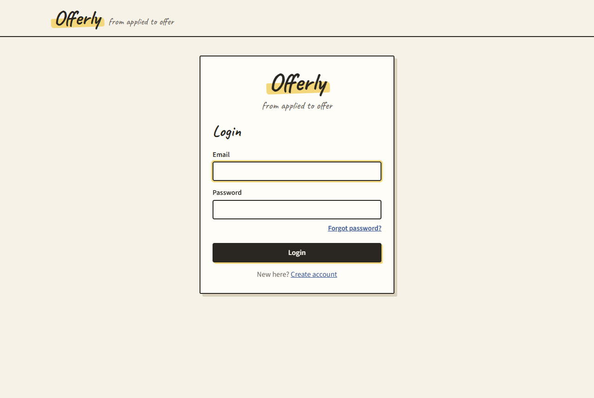 | 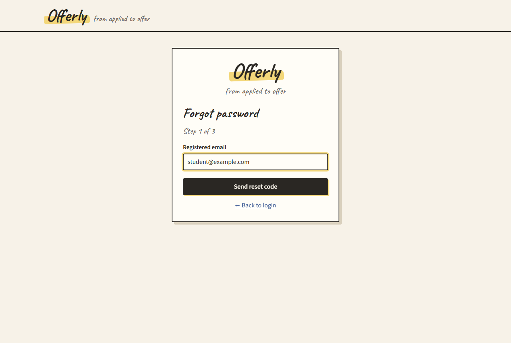 | 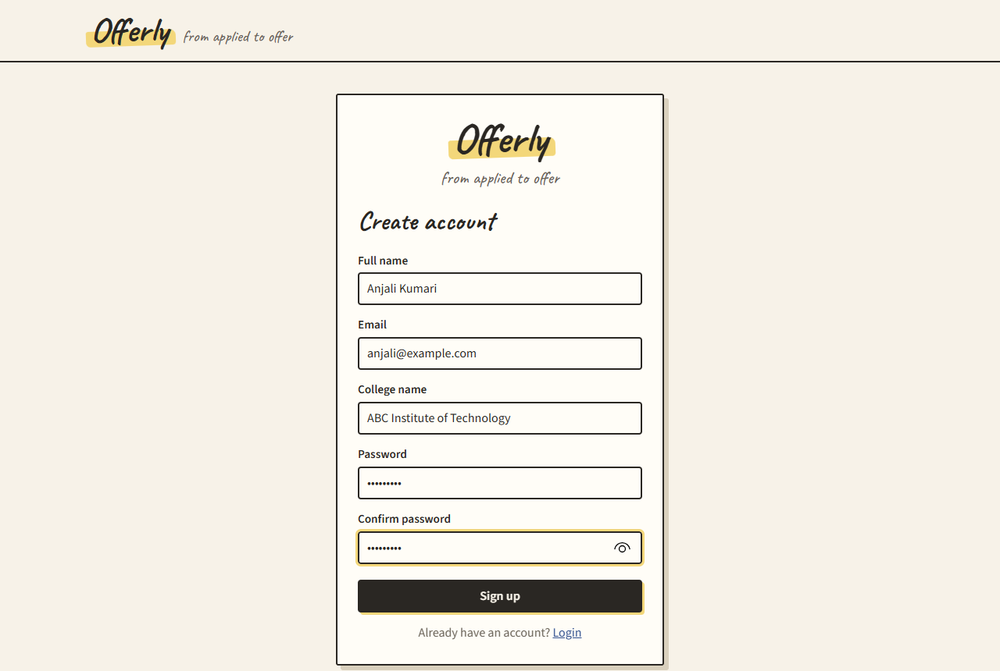 |

### Choose where you want to intern

Shown on first login (and any time from the header). Pick cities, states, *Remote* or *Anywhere in India*.

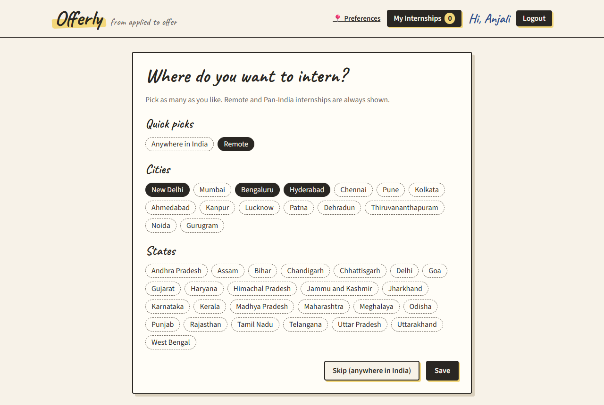

### Dashboard

Six sticky-note category cards. Each card shows how many listings are **near you** (based on your preferences) and how many you have saved.

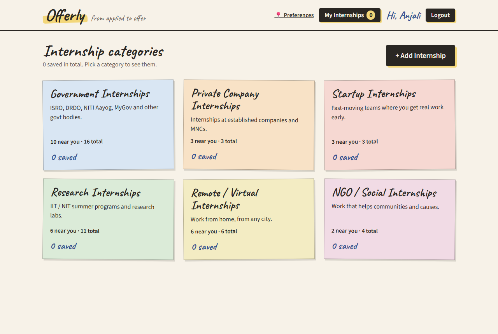

### Category page with real listings

Each card shows an application status badge (Open now, Opens soon, Rolling, Check site, Closed), eligibility, stipend, duration, a deadline countdown, and the official source. Filter by city/state, mode, paid only, or search. The **📍 My locations** chip filters by your preferences.

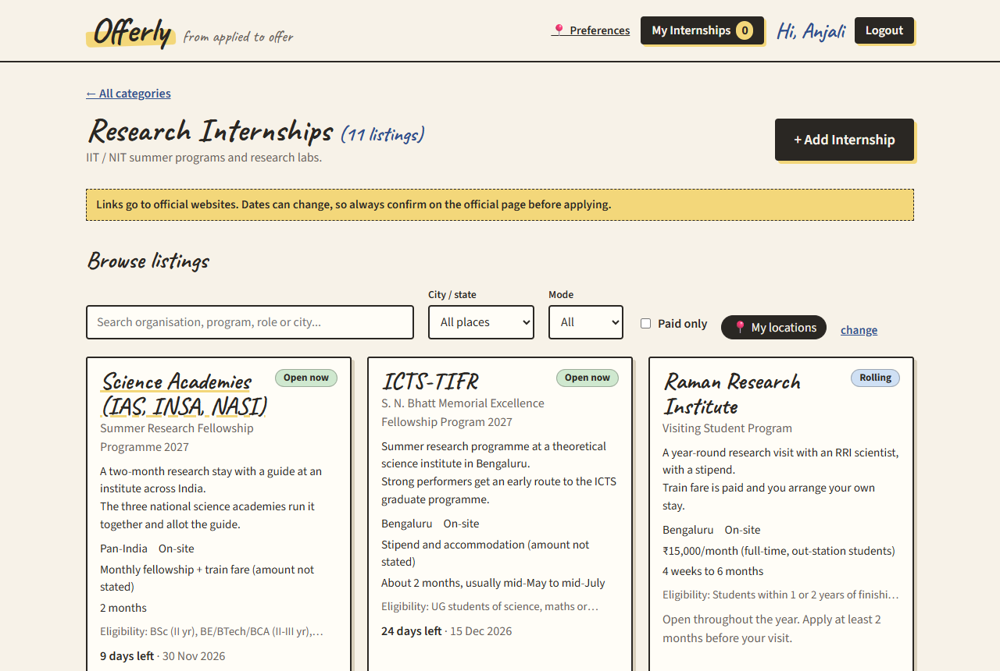

### One-click "+ Add"

"+ Add" copies the listing into *My Internships* instantly. The button turns into a green **✓ Added** (click again to remove) and a toast appears with **Undo** and **View**.

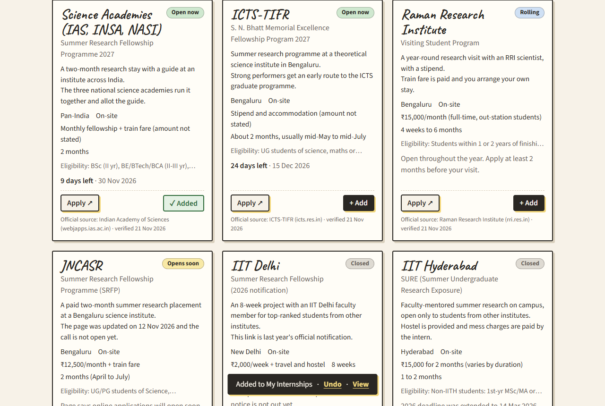

### Listing details

Full eligibility, location, stipend, duration, deadline and the official source on one page.

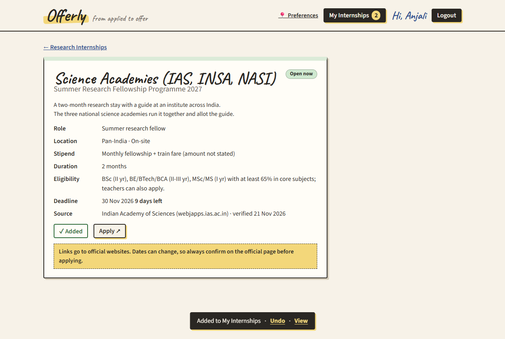

### Quick add (for internships that are not in the listings)

A small modal with only three required fields: company, role and deadline. Extra details are hidden behind "+ more details (optional)".

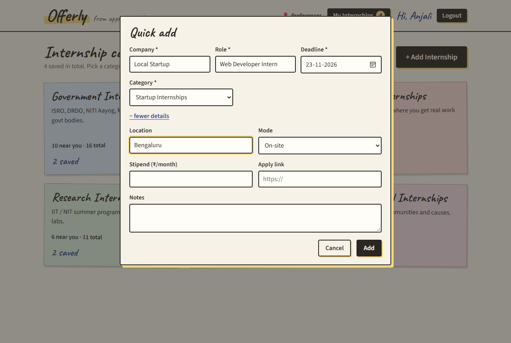

### My Internships

Everything you saved, sorted by nearest deadline and grouped into **Due this week**, **Upcoming**, **No fixed deadline** and **Deadline passed**. Change the status from the dropdown on each card, search, filter, or hide passed deadlines.

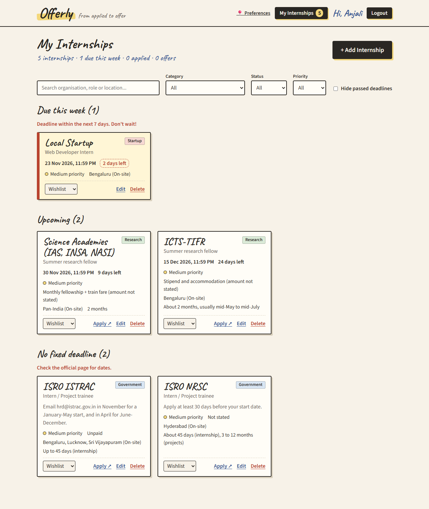

### Works on mobile

A single-column layout, and a floating **📋 N** button always opens My Internships.

| Dashboard | My Internships |
| --- | --- |
| 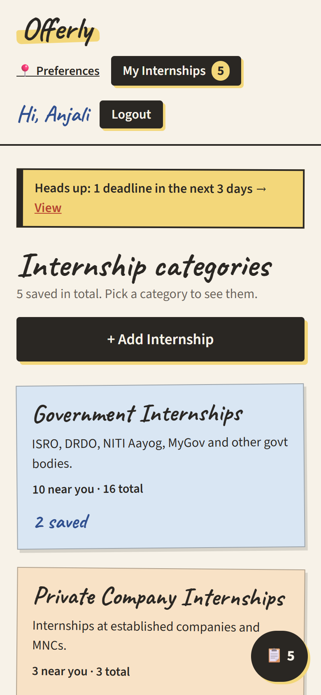 | 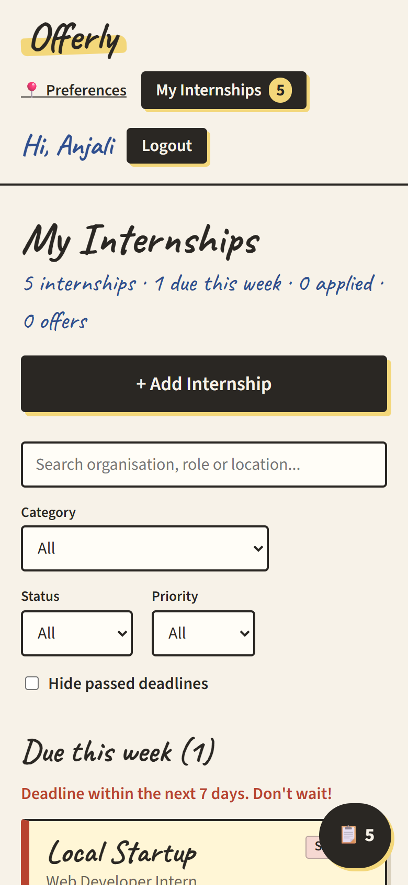 |

---

## Features

**Accounts**
- Sign up, login and logout, with clear error messages (required fields, valid email, minimum 6 characters, passwords must match, "Email already registered", "Wrong email or password")
- Session is remembered after a refresh
- Protected pages: logged-out users are sent to the login page, and logged-in users skip it
- Header shows "Hi, <first name>" and a Logout button
- Forgot password in 3 steps (email, 6-digit code valid for 10 minutes, new password)
- Each user sees only their own data

**Finding internships**
- 6 categories: Government, Private Company, Startup, Research, Remote / Virtual, NGO / Social
- 43 listings with official apply links (16 government, 11 research, 6 remote, 4 NGO, 3 private, 3 startup)
- Location preferences, a "📍 My locations" filter and a city/state dropdown
- Dashboard shows "X near you · Y total" on every category
- Listings are sorted: Open now (nearest deadline first), Rolling, Opens soon, Check site, Closed
- If a deadline has passed, the listing automatically shows as Closed

**Tracking internships**
- One-click "+ Add" with Undo, and "✓ Added" to remove
- Quick add modal for internships that are not in the listings
- Edit (`/edit-internship/:id`) and delete (with confirmation), status dropdown, priority dots
- Deadline countdown (red when 3 days or less), "Due this week" section, dashboard reminder banner
- Header button with a live count, and a floating button on mobile

---

## Where the listing data comes from

Every listing in `src/data/internships.js` was opened on its official page (government, institute, or the company's own site) on **2026-11-21**. Only facts shown on that page are used. When a page does not say something, the app shows "Not stated". Blogs and aggregator sites are never used as links.

Dates can change, so always confirm on the official page before applying. Each category page shows this reminder too.

---

## How it works (short explanation)

- **Routing:** `App.jsx` defines the pages with React Router. `ProtectedRoute` redirects to `/login` when nobody is logged in.
- **Login:** `AuthContext` keeps the current user in state and in localStorage (`offerly-session`). It is a **demo login**: passwords are stored as plain text in the browser. A real app must use a backend (for example Firebase Auth or Node + JWT) with hashed passwords.
- **My Internships data:** `InternshipsContext` holds one shared list for the logged-in user, so the header count and every page always match. `useInternships` saves it to localStorage under `offerly-data-<email>`.
- **Listings:** they are a plain array in `src/data/internships.js`. Helper functions in `utils/listings.js` work out the display status and sorting.
- **Location filter:** `utils/locations.js` checks each listing's cities and states against the user's preferences. Remote and Pan-India listings always match.
- **Toast:** `ToastContext` shows the "Added · Undo · View" message for 4 seconds.

### localStorage keys

| Key | What it holds |
| --- | --- |
| `offerly-users` | all registered users |
| `offerly-session` | the logged-in user |
| `offerly-reset` | the current password-reset code and its expiry |
| `offerly-prefs-<email>` | the places the user wants to intern |
| `offerly-data-<email>` | that user's My Internships list |

---

## How to run

```bash
npm install
npm run dev
```

Then open the local address shown in the terminal (usually http://localhost:5173).

To make a production build:

```bash
npm run build
npm run preview
```

---

## Folder structure

```
offerly/
├── index.html
├── package.json
├── vite.config.js
├── docs/screenshots/          images used in this README
├── supabase/                  database files for the planned Supabase upgrade
│   ├── schema.sql
│   └── seed.sql
├── scripts/
│   └── make-seed.mjs          builds seed.sql from the listings file
└── src/
    ├── main.jsx               entry point (Router + providers)
    ├── App.jsx                all routes
    ├── App.css                all styles, CSS variables in :root
    ├── context/
    │   ├── AuthContext.jsx        user, login, signup, logout, password reset
    │   ├── InternshipsContext.jsx the user's internships, shared by all pages
    │   └── ToastContext.jsx       the "Added · Undo · View" toast
    ├── hooks/
    │   └── useInternships.js      add / update / delete + save to localStorage
    ├── components/
    │   ├── Header.jsx
    │   ├── ProtectedRoute.jsx
    │   ├── CategoryCard.jsx
    │   ├── ListingCard.jsx        a listing on a category page
    │   ├── ListingAddButton.jsx   "+ Add" / "✓ Added"
    │   ├── QuickAddModal.jsx
    │   ├── InternshipCard.jsx     a saved internship on a category page
    │   ├── MyInternshipCard.jsx   a card on the My Internships page
    │   ├── DeadlineBadge.jsx
    │   └── FloatingButton.jsx     mobile "📋 N" button
    ├── pages/
    │   ├── Login.jsx
    │   ├── Signup.jsx
    │   ├── ForgotPassword.jsx
    │   ├── Preferences.jsx
    │   ├── Dashboard.jsx
    │   ├── CategoryPage.jsx
    │   ├── ListingDetail.jsx
    │   ├── MyInternships.jsx
    │   └── AddInternship.jsx      full edit form
    ├── data/
    │   └── internships.js         the 43 verified listings
    ├── lib/
    │   └── supabase.js            Supabase client (not used by the app yet)
    └── utils/
        ├── storage.js             localStorage helpers with try/catch
        ├── categories.js          the 6 categories and the status list
        ├── dates.js               daysLeft, deadlineText, formatDate, formatTime
        ├── listings.js            status, sorting, listing -> internship
        └── locations.js           states, cities, preferences, location matching
```

---

## Roadmap

The app currently runs fully in the browser. The `supabase/` folder holds the database design for the next step: real login with Supabase Auth, listings stored in a database, an admin panel, and a daily robot that checks the official links for changes. The app does not use Supabase yet.

---

## Tech

React 18 · Vite · React Router 6 · plain CSS · localStorage · fonts: Caveat and Source Sans 3 (Google Fonts)


- Developed & Maintained By: < Anjali kumari><Ankur Tiwari>< CSE and section=11> 
- Full Stack Development Team
- © 2026 ABESEC Ghaziabad. All Rights Reserved.
